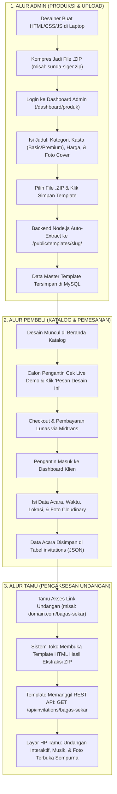

# 📄 SPESIFIKASI & ALUR ARSITEKTUR: SISTEM UPLOAD TEMPLATE VIA FILE .ZIP

**Proyek:** `asm.invitation` (`undang_an.digital`)  
**Dokumen:** Panduan & PRD Teknis Sistem Template Eksternal (.ZIP Engine)  
**Status:** Disetujui & Siap Diterapkan  

---

## 1. LATAR BELAKANG & FILOSOFI ARSITEKTUR

### 1.1. Pemisahan Peran (*Separation of Concerns*)
Untuk menjaga sistem tetap bersih, stabil, dan dapat berkembang (*scalable*), arsitektur platform dibagi menjadi dua entitas independen yang hidup berdampingan di satu server VPS yang sama (`103.247.11.210`):

1. **Wadah Toko E-Commerce & Pusat Data (`ASM Undangan Digital`):**
   * Berfungsi sebagai etalase katalog, kasir transaksi, pemrosesan pembayaran (Midtrans), registrasi akun klien, editor form acara, dan penyimpanan kuota foto Cloudinary.
   * Bertindak sebagai **Pusat REST API** (`GET /api/invitations/:slug`) yang siap menyediakan data acara pengantin secara *real-time*.
   * Admin **tidak perlu membuka atau mengedit kodingan React toko ini** saat ada desain template baru.

2. **Produk Template Undangan (File `.ZIP` Mandiri):**
   * Desainer/Admin bebas merakit tampilan undangan di laptop masing-masing menggunakan teknologi web standar (HTML, CSS, JavaScript, animasi GSAP, 3D Canvas, atau efek musik).
   * Masing-masing template terisolasi di dalam foldernya sendiri sehingga **tidak ada risiko tabrakan CSS/JS antar desain**.

---

## 2. STANDAR STRUKTUR FILE `.ZIP` TEMPLATE

Setiap template yang dirakit di laptop wajib dikompres menjadi file `.zip` dengan struktur direktori standar berikut:

```text
📦 desain-template-kamu.zip
├── 📄 index.html        # Entry point utama halaman undangan
├── 🎨 style.css         # Styling, animasi, font khusus, & layout HP
├── ⚡ script.js        # Logika musik autoplay, countdown, & pembaca API
└── 📂 assets/           # Folder aset lokal template
    ├── 🖼️ background.jpg / svg
    ├── 🎵 audio-default.mp3
    └── 🎭 ornamen-budaya/
```

### Aturan Wajib di dalam `script.js` Template:
File `script.js` di dalam template bertugas menarik data acara pengantin dari API toko dengan contoh kode standar 1-baris:

```javascript
// Mengambil slug dari URL (misal: /bagas-dan-sekar)
const slug = window.location.pathname.split("/").filter(Boolean).pop();

// Mengambil data resmi pengantin dari server toko
fetch(`/api/invitations/${slug}`)
  .then((res) => res.json())
  .then((invitation) => {
    const details = invitation.event_details;

    // 1. Pasang Nama Mempelai
    document.getElementById("nama-pria").innerText = details.mempelai.pria.nama;
    document.getElementById("nama-wanita").innerText = details.mempelai.wanita.nama;

    // 2. Pasang Foto Profil (jika ada)
    if (details.mempelai.pria.foto) {
      document.getElementById("foto-pria").src = details.mempelai.pria.foto;
    }

    // 3. Pasang Galeri Foto Cloudinary (untuk Paket Premium)
    if (details.photos && details.photos.length > 0) {
      const galleryContainer = document.getElementById("galeri-container");
      details.photos.forEach((fotoUrl) => {
        const img = document.createElement("img");
        img.src = fotoUrl;
        galleryContainer.appendChild(img);
      });
    }

    // 4. Pasang Musik Latar
    if (details.music_url) {
      document.getElementById("audio-source").src = details.music_url;
    }
  })
  .catch((err) => console.error("Gagal memuat data undangan:", err));
```

---

## 3. FLOWCHART DIAGRAM SISTEM (END-TO-END)



---

## 4. RENCANA TEKNIS PENGERJAAN DI SISTEM KITA

### 4.1. Sisi Backend (Node.js & Express)
1. **Pemasangan Modul Unzip:** Menggunakan pustaka ringan seperti `adm-zip` untuk menangani dekompresi file `.zip`.
2. **Direktori Penyimpanan Static:** Disediakan folder publik:
   `backend/public/templates/[slug-template]/`
3. **Endpoint Upload:**
   * Route: `POST /api/templates/upload-zip`
   * Menerima multipart-form (File ZIP + Cover Gambar + Data Harga & Paket).
   * Melakukan verifikasi: wajib terdapat file `index.html` di dalam arsip `.zip`.
   * Otomatis menyimpan `demo_url = '/templates/[slug-template]/index.html'`.

### 4.2. Sisi Frontend Admin (`ProdukPage.tsx`)
1. **Komponen Upload ZIP:**
   * Menambahkan input file khusus berekstensi `.zip` di form modal tambah template.
2. **Pratinjau Status:**
   * Indikator progres ekstraksi file zip saat tombol simpan diklik.

### 4.3. Sisi Tampilan Undangan Tamu (`UndanganTamuPage.tsx`)
1. **Dual-Mode Viewer:**
   * Jika template merupakan tipe bawaan standar ➔ menggunakan layout React default.
   * Jika template merupakan hasil upload ZIP ➔ menampilkan template tersebut secara responsif *full-screen* (100dvh) di mana template luar otomatis menyerap data acara dari API.

---

## 5. KEUNGGULAN ARSITEKTUR INI

* ✅ **0% Koding untuk Admin:** Siapapun bisa menambah 50 atau 100 template baru langsung dari browser.
* ✅ **Bebas Kreasi Desain:** Desainer tidak terkekang oleh komponen React bawaan; bebas memakai animasi JavaScript modern, SVG, maupun gaya CSS apapun.
* ✅ **Hemat Biaya & 1 Server VPS:** Seluruh sistem toko, database, dan puluhan folder template hidup di VPS yang sama (`103.247.11.210`).
* ✅ **Keamanan Terjamin:** Kodingan kasir e-commerce dan database pembeli tidak akan pernah tersenggol atau rusak saat ada penambahan desain baru.

